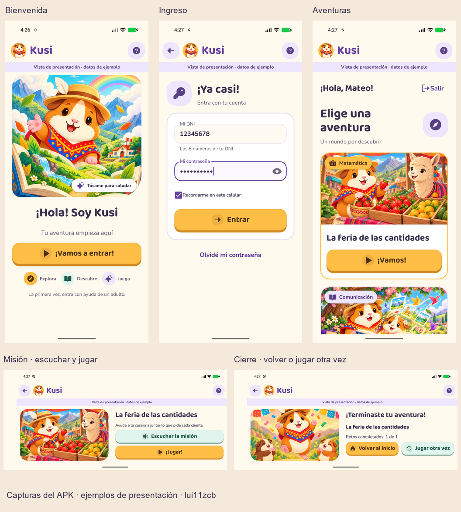

# Kusi

Proyecto integrador de experiencias educativas de juego para primero de primaria en Perú.

Actualización de diseño: **lui11zcb · luiscb.once@gmail.com**. Se conserva la autoría histórica de cada contribución y las licencias de los recursos.

## Ver el proyecto

Los paneles de **administración y docente** comparten `web/`. Con Django en 8000, Spring en 8080 y Vite en 5173, abrir `http://127.0.0.1:5173/` e ingresar con una cuenta del rol correspondiente. Si la cuenta tiene ambos roles, elegir el panel. El nuevo administrador ya está integrado; no requiere la maqueta antigua.

1. Preparar el `.env` local a partir de `.env.example`, con PostgreSQL y la misma clave interna para Django/Spring. No subir secretos.
2. Django: desde `admin-api`, entorno virtual con `requirements.txt`; ejecutar `python manage.py runserver 127.0.0.1:8000`.
3. Spring: Java 21; desde `edu-api`, `mvnw.cmd spring-boot:run` en Windows. [Configuración y contratos](edu-api/README.md).
4. Web: desde `web`, `npm ci` y `npm run dev`.
5. Android: abrir `movil/` en Android Studio o compilar con `gradlew.bat assembleDebug`. [Instrucciones y límites](movil/README.md).

La base existente y sus migraciones se conservan; revisar la configuración antes de iniciar sobre una instalación nueva. El proveedor de propuestas usa la clave local Groq; sin clave se mantiene la solicitud pendiente.

## Presentación Android

El APK de desarrollo se genera en `movil/app/build/outputs/apk/debug/app-debug.apk`. Incluye **Kusi**, con acceso real, y **Kusi · presentación**, recorrido aislado con ejemplos visibles. En presentación usar DNI `12345678` y cualquier contraseña; después crear y repetir una de ocho caracteres o más. Elegir aventura → misión horizontal → «¡Jugar!» → «Terminar» en la página técnica → cierre. No es una cuenta, biblioteca o juego generado reales. La variante de producción no incluye esa actividad.

## Estado y diseño

- [Avance del martes 20 de octubre](docs/AVANCE_20_OCTUBRE.md).
- [Verificaciones y límites](docs/VERIFICACION_20_OCTUBRE.md).
- [Diseño vigente de administración, docente y Android](DESIGN.md).
- [Alcance de producto](PRODUCT.md) y [autoría](AUTORIA.md).

Este avance conserva pendiente la generación del paquete real, validaciones completas e integración biblioteca/juego/eventos. No declara cerrado el Sprint 2 ni demuestra eficacia educativa.
