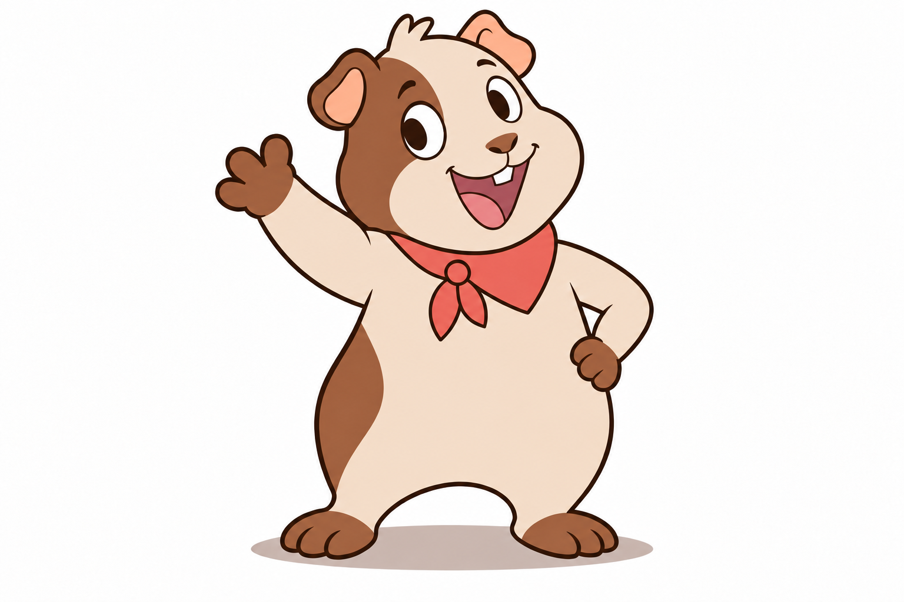
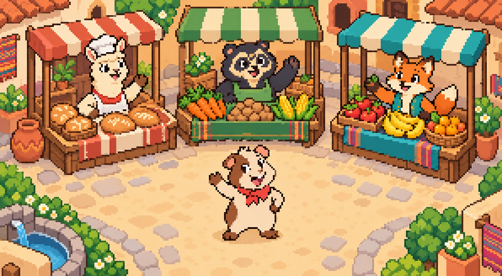

# Historial de arte de Kusi: pixel art cartoon

22 de octubre de 2026 · **lui11zcb · luiscb.once@gmail.com**.

**Aviso vigente, 23 de octubre de 2026:** Luis eligió **cartoon 2D** y dejó atrás la ruta pixel art. La guía actual es [ARTE_CARTOON.md](ARTE_CARTOON.md), junto con el [plan de demostración personal](PLAN_DEMO_PERSONAL_CARTOON.md). Este archivo conserva referencias, preferencias y resultados históricos; sus exigencias de cuadrícula e indexación no rigen el nuevo kit.

La [versión v1 integrada en Phaser](PRODUCCION_CUY_NINO.md) **fue rechazada por Luis** por ojos, brazos y deformaciones. El paso 02 de reposo también fue rechazado por el brazo y el cuello; la corrección está **suspendida**, no pendiente de aprobación. Las métricas y pruebas técnicas permanecen como evidencia del intento. No retomar poses, animación ni integración por instrucciones históricas. [Estado del proyecto](CONTEXTO_ACTUAL.md).

**Identidad que sigue vigente:** el cuy aprobado es **el avatar del niño**; Kusi guía es otro personaje. Conservar el [original cartoon aprobado](arte/referencias/cuy-cartoon-aprobado.png), su identidad marrón/beige/coral y su pañuelo, sin regenerarlo ni enviar imágenes en el chat. Consultar el [historial del procedimiento de animación](PLAN_ANIMACION_CUY_NINO.md) para los intentos conservados; la aprobación del original no se extiende a esas adaptaciones.

## Referencias que conservar

Luis aprobó este diseño cartoon después de corregir anatomía y aclarar el color beige. Conservar su silueta, carácter y relaciones de color. La imagen contiene variaciones suaves de tono. En el intento pixel art se buscó adaptar esa referencia a una paleta indexada; las restricciones de ese intento se conservan abajo como historial y no se trasladan al nuevo kit cartoon.

La escena es una referencia de composición y ambiente, no un mapa con capas, colisiones y personajes independientes. El cuy de esa escena sigue siendo una exploración. La producción posterior del avatar aislado cuenta con cuatro vistas y ciclos propios que fueron rechazados visualmente; no se reconstruyó el mercado con esta ilustración.

## Identidad y preferencias de Luis

- Cuy cartoon bípedo, cuerpo completo, silueta amable, expresiones físicas y faciales exageradas. Referencias de actuación: elasticidad y economía de formas de Cuphead, Bob Esponja y Looney Tunes, conservando identidad propia.
- Marrón natural y beige piel claro, sin aclarar mediante brillo o exposición global; pañuelo coral como acento. Los interiores de ambas orejas deben pertenecer a la misma paleta y anatomía.
- Pelaje representado con pocas formas; mechón conectado con la cabeza, contorno cerrado y relleno hasta la punta. Ojos y pupilas claros, mirada coherente; sin reflejos añadidos.
- Brazos completos y articulaciones legibles. Evitar que el codo se confunda con una línea del pecho; conservar manos visibles, proporciones y la convención de tres dedos redondeados de este diseño. No convertir esa convención en una regla universal para cualquier especie.
- Orejas consistentes de cuy: evitar una oreja de perro caída y otra con construcción incompatible. La perspectiva puede modificar su posición.
- Separar el nudo y las puntas del pañuelo de mandíbula, hombro y brazo para evitar tangencias confusas.
- Para un personaje u objeto aislado, **un solo sujeto por imagen**, sin láminas de varias poses salvo que se pidan. Una escena solicitada sí puede tener varios animales.

Usar color plano y una jerarquía aproximada **60/30/10** como orientación flexible: dominante descansado, secundario que separe masas y acento en el foco. Controlar la saturación. Evitar pelaje minucioso, plástico, porcelana, neón, reflejos metálicos, brillos, degradados automáticos y volumen artificial. Luis pidió eliminar sombras del cuerpo, cuello y axilas del personaje. Las sombras de escenario, si se usan, deben ser bloques gráficos deliberados; no reintroducir con ellas el acabado rechazado del personaje.

**Prioridad infantil:** reconocer personaje/objeto y acción a su tamaño de juego, zonas táctiles amplias, controles estables, texto corto, buen contraste y animación con propósito. No llenar la escena de detalle o movimiento que oculte la tarea. La preferencia de niños de 6–7 años por este estilo sigue sin comprobarse con usuarios.

## Limpieza específica de pixel art

Estas son las exigencias que Luis añadió, no resultados automáticamente garantizados por el generador:

1. **Sin píxeles huérfanos:** bloques deliberados, bordes limpios y revisión de cada punto suelto. No borrar automáticamente detalles pequeños que sí tengan función.
2. **Contornos coherentes:** evitar esquinas dobles, grosores accidentales y escalones irregulares. Usar progresiones claras en diagonales y curvas; la regularidad debe servir a la forma.
3. **Sombreado controlado:** pocos tonos, agrupaciones planas; dithering solo si ayuda. Evitar degradados, desenfoque y suavizado automático. En el cuy, respetar la ausencia de sombras solicitada.
4. **Paleta realmente indexada:** elegir y comprobar un conjunto pequeño de colores (16/32/64 fueron ejemplos, no una cifra final ya aprobada). No confundir una apariencia pixelada con una paleta restringida.
5. Trabajar en resolución nativa, ampliar con **nearest neighbor y factores enteros** para revisar. Al animar, mantener cuadrícula, lienzo, escala, paleta, proporciones y punto de apoyo entre fotogramas.

En el intento v1 se fijaron lienzo de **112 × 128**, anclaje **(56, 117)**, escala de mundo **1** y una paleta de trabajo de **8 muestras RGB**. El PNG final usa **7 RGB visibles más transparencia**, con indexación comprobada sin pérdida; el editable nativo permanece en RGBA. Estos valores se registran en la [producción del avatar](PRODUCCION_CUY_NINO.md); no derivan automáticamente del tamaño detectado por Fixer ni fijan el nuevo kit cartoon. En ese intento no se cerraron una escala de baldosas y una paleta compartida para el resto del escenario.

## Prueba real de Pixel Art Fixer

Fuente: [Retro-Diffusion/pixel-art-fixer](https://github.com/Retro-Diffusion/pixel-art-fixer), licencia MIT. Versión probada: [ef376e57e1c272633ca2dbf5f29ec3fcf6596465](https://github.com/Retro-Diffusion/pixel-art-fixer/tree/ef376e57e1c272633ca2dbf5f29ec3fcf6596465).

Se ejecutó localmente en CPU mediante `pixelfixer.api.process(bytes, mode="full")`, reconstrucción predeterminada en dos etapas. El CLI de ese commit falló con `ModuleNotFoundError: No module named 'detector'`; no se corrigió el repositorio externo y se utilizó la API que sí funcionó. No se enviaron estas imágenes a un servicio web de Pixel Art Fixer.

| Prueba | Entrada | Resultado nativo | Colores RGB de salida | Vista ampliada |
|---|---|---|---|---|
| Cuy aislado | 1287 × 1222 | 111 × 107 | 826 | 8×, 888 × 856 |
| Mercado con animales | 1672 × 941 | 298 × 164 | 27 115 | 5×, 1490 × 820 |

Los dos resultados conservan alfa completamente opaco. El fondo blanco del cuy **no es transparente**. La confianza de detección fue media para cuy y alta para mercado; es una medida del detector, no aprobación artística. Las [métricas del cuy](arte/evidencias/cuy-pixel-fixer.json) y [del mercado](arte/evidencias/mercado-pixel-fixer.json) conservan versión, método y hash de entrada.

La herramienta ayuda a reconstruir una cuadrícula, pero **no garantiza una paleta final de 16/32 colores**, anatomía correcta, contornos perfectos ni continuidad de animación. Su reducción de colores para detectar estructura no equivale a indexar la imagen final. Tampoco separa automáticamente fondo, objetos, vendedor y jugador en capas jugables. La versión neuronal mencionada por el sitio no está incluida en este código local.

### Archivos conservados en Kusi

Los siguientes archivos conservan las referencias y sus pruebas iniciales. El avatar jugable posterior tiene sus propios [editables, exportaciones y evidencia](PRODUCCION_CUY_NINO.md), ya integrados en `juego/public/dibujos/`; el mercado de esta lista sigue siendo referencia:

- [Cuy cartoon aprobado](arte/referencias/cuy-cartoon-aprobado.png).
- Cuy pixel art: [original](arte/referencias/cuy-pixel-original.png), [nativo procesado](arte/referencias/cuy-pixel-native.png), [vista 8×](arte/referencias/cuy-pixel-preview.png) y [comparación](arte/referencias/cuy-pixel-comparacion.png).
- Mercado con animales: [original](arte/referencias/mercado-animales-original.png), [nativo procesado](arte/referencias/mercado-animales-native.png), [vista 5×](arte/referencias/mercado-animales-preview.png) y [comparación](arte/referencias/mercado-animales-comparacion.png).
- [Manifiesto de procedencia y hashes](arte/manifest.json).
- [Copia de consulta de la skill general](arte/skill-diseno-cartoon/SKILL.md). Su original está instalado en la carpeta personal de skills de Luis; esta copia no se activa por estar dentro de `docs/`.

Las ilustraciones originales se generaron con la herramienta de imágenes del chat a partir del encargo de Luis. Los briefs del manifiesto son resúmenes, no transcripciones literales de los prompts ni certificados de trabajo manual. Las imágenes procesadas derivan de esos originales; las ampliaciones son nearest neighbor. No se incluyeron aquí el clon del procesador ni sus dependencias.

### Entorno local utilizado

El laboratorio reproducible de esta computadora permanece en:

`C:/Users/luis/.codex/visualizations/2026/10/20/01a1573c-ba1d-7133-b3a6-5f09fbc4b77d/pixel-art-fixer-review/`

Contiene `source/`, `deps/`, `test_cuy.py`, `process_market.py`, `dependency-report.json` y resultados. Python 3.12 del runtime local, numpy 2.5.4, scipy 1.18.1, opencv-python-headless 5.0.0.93 y Pillow 13.0.0; dependencias aisladas en `deps/`, sin incorporarlas a Kusi ni instalarlas globalmente. En otra máquina se debe preparar un entorno equivalente; copiar estas imágenes y métricas no instala el procesador.

## Procedimiento histórico de referencia a recurso jugable

Los pasos siguientes registran la ruta pixel art usada en el intento. **No son instrucciones para el siguiente encargo:** seguir la [guía cartoon vigente](ARTE_CARTOON.md) y no reanudar esta producción suspendida.

1. Para el primer recurso ya está confirmado: **cuy del niño/jugador**, a partir de la referencia creada; Kusi guía se conserva aparte. Para los recursos siguientes, identificar su función en la escena. Usar la referencia aprobada más reciente y las reglas generales de `diseno-cartoon` cuando corresponda.
2. Definir escala, vista y paleta comunes antes de producir muchas piezas. Crear personaje, objetos, puestos y fondo por separado; una sola ilustración del mercado no permite animar sus componentes.
3. Generar o dibujar la pieza, revisar identidad y legibilidad; usar Pixel Art Fixer como paso auxiliar si la cuadrícula generada requiere reconstrucción.
4. Limpiar en Pixelorama u otro editor apropiado: indexación final, contornos, píxeles sueltos, transparencia y puntos de apoyo. En la primera versión del cuy se ejecutaron recetas de píxeles mediante comandos nativos del puente MCP y se guardó el editable; no se afirma dibujo manual por un artista. Distinguir la paleta restringida del proyecto RGBA de la indexación comprobada del PNG final.
5. Preparar vistas y animaciones consistentes del recurso necesario (por ejemplo reposo/caminar/interactuar); mantener contacto de pies, anclaje y dimensiones al exportar spritesheets. No procesar cada fotograma con una cuadrícula diferente.
6. Integrar por claves en el juego existente, adaptar colisiones/interacciones y verificarlo a tamaño real en computadora y Android. Actualizar procedencia y documentación con lo que efectivamente se haya integrado.

Phaser sigue siendo el motor. Blender es opcional para una producción 3D que luego renderice 2D; no es obligatorio para dibujar pixel art ni hay una migración pendiente que deba ejecutarse automáticamente. El siguiente trabajo debe acordarse según el encargo actual de Luis, manteniendo por separado el arte y las integraciones funcionales que faltan para Sprint 2.

El cuy del niño recorrió estas etapas hasta su integración inicial de reposo/caminar. Pasaron ocho pruebas del juego, el build y una prueba táctil adicional en Chromium móvil emulado: nueve pruebas verificadas entre ambas ejecuciones. La revisión visual terminó en rechazo y Android real no se comprobó en ese bloque. Se conservan los resultados y archivos históricos; no se continúa su corrección ni se exige esta animación para la demostración cartoon propuesta.
